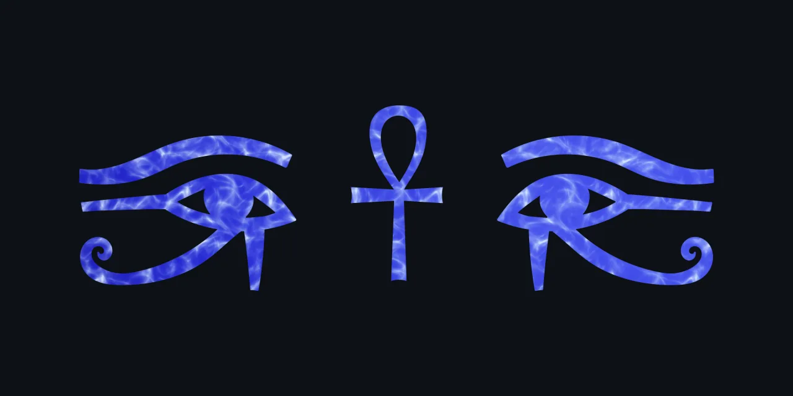

liv
===

LIV is the first real stateful memory for AI agents. It keeps everything the
human and their agent say, as plain text tables, Multi-Sheet Tab-Separated
Values (MTSV), that both can read and use. LIV debuts with Hermes Agent.

Why It Is Useful
----------------

LIV's memory is a relational database: a book for each kind of record, a
sheet for its table, a column for each property, and a row for each fact,
each stated once and all interconnected as one, as Codd set out in 1970.
Everyone and everything the agent comes to know is given an identity of its
own, kept from session to session, so what is said today joins what was
said before.

The memory holds two layers of one record. Below lies the raw transcript:
every turn, word for word, as it was spoken, only ever added to, never
summarized or rewritten. Above it rests the meaning: what each turn says,
written by the agent as RDF statements, a row for each, that compose, turn
by turn, the human's full knowledge graph.

Your agent wakes up remembering, in any session and at any turn. It begins
at the top of the graph, sees what matters most and what was said last,
and can always return to the exact words.

The beauty is in its simplicity. LIV is open source, mechanical and free:
plain files, open standards and proven foundations. It is a step for
humanity to take ownership of its most private and sovereign data. Your
memory lives on your machine, organized as your folders are, speaks to no
network, and answers only to you. There is nothing to configure: install
it, and stateful memory begins with the next turn.

Forgetting is now forgotten.

Get Started
-----------

* Install: copy liv/ to $HERMES_HOME/plugins/liv/, or, once listed in the Hermes plugin catalog, `hermes plugins install liv`
* Select: set `memory.provider: liv` in Hermes's config.yaml, with the memory toolset on
* Use: before each turn the agent is given the top of its graph, and it has two tools, `liv_write` and `liv_find`
* See: `hermes liv overview`, `zoom`, `filter` or `details-on-demand`, run in the folder you worked in

How It Works
------------

* Database: three books of one sheet each, every sheet a relation in normal form (Codd, 1970), written as MTSV: entities, a row for each turn's words; runs, a row for each line of them; dataset, a row for each statement
* Identity: each thing an IRI, the URN of a random UUID, minted once and reused in every later session
* Transcript: each turn an activity, the human's and the agent's words the entities it generates, each attributed and timed (PROV-DM)
* Meaning: the agent's statements, written in Turtle (RDF 1.1), kept in the named graph of the turn that made them; the graph's names, nesting and top concepts in SKOS; a write that breaks a SKOS integrity condition refused whole
* Waking: before each turn, the top concepts, each with the number of turns that speak of it and the last time one did, the most first (SPARQL's Count and Max)
* Finding: overview first, zoom and filter, then details-on-demand (Shneiderman, 1996), down to a turn's exact words, a page at a time
* Folders: one memory for each folder the agent works in, under hermes_home/liv/, at that folder's path
* Modules: thirteen in six groups, format, data, knowledge, lookup, view and hermes, each hiding one design decision (Parnas, 1972) and using only the modules before it

Details
-------

* Format: [MTSV, an IETF Internet-Draft](https://github.com/demos-ra/mtsv-spec)
* Requirements: Hermes Agent, tested with v0.23.1; Python's standard library only
* Version: 0.1.1
* Tests: `python3 -m unittest discover -s tests`, run from this folder with Hermes Agent's source on PYTHONPATH; one test per requirement
* Layout: [liv/](liv/), the plugin; [tests/](tests/), its tests; [plugin-catalog/liv.yaml](plugin-catalog/liv.yaml), the Hermes catalog entry
* License: [GPLv2](LICENSE)

Get Help
--------

* Issues: [liv issue tracker](https://github.com/demos-ra/liv/issues)
* Security: [SECURITY.md](SECURITY.md)
* Maintainer: Demos Ra
* More: [all MTSV tools by Demos Ra](https://github.com/demos-ra)
